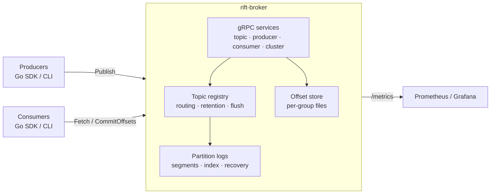

# Rift

A Go-native distributed event streaming and work-queue engine: replayable
streams and acknowledged work queues behind one API, built correctness-first
and measured, not asserted.

> **Status: milestone R1 complete — single-node broker.** Rift durably stores
> partitioned topics in a crash-safe log, serves producers and stream consumers
> over gRPC, persists consumer-group offsets, and enforces retention. It is a
> research and engineering platform, not yet production software.

## Milestones

| Stage | Status | Delivers | Exit evidence |
| --- | --- | --- | --- |
| R1 Single node | ✅ Done | Log storage, protocol, SDK, CLI, offsets, retention | Crash at arbitrary write points and simulated power loss; no acknowledged record lost |
| R2 Metadata | ⏳ Next | 3-node membership, Raft metadata | Kill the metadata leader; a valid leader takes over |
| R3 Replication | Planned | Leader/follower logs, high watermark, epochs, fencing | Acknowledged records survive failures under the chosen policy |
| R4 Stream groups | Planned | Group membership, assignment, rebalance | Rebalance under load without lost ownership |
| R5 Queue mode | Planned | Leases, ACK/NACK, retries, DLQ | Workers killed after claim are redelivered within retry bounds |
| R6 Adaptation | Planned | Backpressure, hot-partition placement | Baseline vs. candidate skew benchmarks |
| R7 Advanced | Planned | Tiered storage, security, more SDKs, chaos suite | Published correctness and performance report |

Details and evidence: [docs/roadmap.md](docs/roadmap.md).

## What works today

- **Durable partitioned log**: segmented append-only files with a CRC-32C
  checksum per record, a sparse offset index, size- and age-based rotation,
  and batched (group-commit) fsync.
- **Crash recovery**: on startup each partition is validated; a torn or
  corrupt tail is truncated and reported, indexes are rebuilt, and damage in
  older, already-fsynced segments stops startup instead of silently losing data.
- **Explicit acknowledgments**: each publish chooses `fsynced` (default; on
  disk before the ack) or `written` (in the OS page cache), and the ack states
  which level held.
- **Topics**: atomic create/delete, keyed routing (same key → same partition,
  publish order kept) and round-robin for keyless records, per-topic retention.
- **Consumption**: multi-partition long-poll fetch, replay from any retained
  offset, durable consumer-group offsets.
- **Operations**: retention by age or size, disk watermarks (warn at 85%,
  reject publishes at 95%), JSON logs, `/healthz` and `/readyz`, Prometheus
  metrics.
- **Go SDK** (`pkg/client`): batching producer with a bounded buffer and
  bounded retries, stream consumer with manual or automatic commits, seek,
  and reset policies; optional gzip.
- **CLI** (`rift`): cluster status, topic admin, publish, consume.

## Architecture



Publish path: route the record to a partition → append to its log → fsync if
the durability level requires it → acknowledge with partition, offset, and
durability. Replication (R3) will add a quorum step before the acknowledgment.
More in [docs/architecture.md](docs/architecture.md) and the on-disk format in
[docs/storage-format.md](docs/storage-format.md).

## Quick start

Prerequisites: Go 1.26+, Git, Make, a C compiler (for the race detector), and
Docker with Compose for the observability stack. Code-generation and lint tools
are pinned in `tools/` and run through `go tool`; no system `protoc` is needed.

```sh
git clone https://github.com/jayyy255/rift.git
cd rift
make run    # builds and starts a broker: gRPC :7070, metrics :9100, data in ./data
```

In another terminal:

```sh
./bin/rift topic create orders --partitions 6
./bin/rift publish orders --key customer-17 --data '{"order_id":101}'
seq 1 5 | ./bin/rift publish orders --stdin --durability written
./bin/rift consume orders --group analytics --mode stream --max-messages 6
./bin/rift topic describe orders
```

`rift consume` with `--group` resumes from the group's committed offsets and
commits after each printed batch. Use `--from earliest|latest`, `--output json`,
and `--idle-timeout` for scripting. The broker's flags are documented in
[configs/README.md](configs/README.md).

### Go SDK

```go
c, _ := client.Dial("127.0.0.1:7070")
defer c.Close()

p := c.NewProducer("orders", client.ProducerConfig{Durability: client.DurabilityFsynced})
md, err := p.Send(ctx, client.Record{Key: []byte("customer-17"), Value: []byte(`{"order_id":101}`)})
p.Close()

cons, _ := c.NewConsumer(ctx, client.ConsumerConfig{Topic: "orders", Group: "analytics", AutoCommit: true})
msgs, err := cons.Poll(ctx)
cons.Close(ctx) // commits progress
```

A complete, runnable version is in [examples/quickstart](examples/quickstart/main.go)
(`go run ./examples/quickstart` with a broker running).

### Observability stack

```sh
make dev-up     # Prometheus :9090, Grafana :3000 (anonymous admin), Toxiproxy :8474
make dev-down
```

Useful metrics: `rift_produce_latency_seconds`, `rift_fsync_latency_seconds`,
`rift_partition_high_watermark`, `rift_consumer_group_lag`,
`rift_storage_recovery_truncated_bytes_total`, `rift_disk_used_ratio`.

## Guarantees

| Property | R1 behavior |
| --- | --- |
| Ordering | Within a partition. Records with the same key keep publish order. |
| Delivery | At-least-once. Retries after a lost response, or uncommitted consumption, can produce duplicates. |
| `fsynced` ack | The record is on the broker's disk; survives process crash and power loss. |
| `written` ack | The record is in the page cache; survives a process crash, flushed within `--flush-interval` (1s). |
| Replicated (quorum) ack | Not available until R3. |
| Cross-partition batches | Not atomic. |

Known R1 limitations: records are stored uncompressed (gzip applies on the
wire), consumers can read records before they are fsynced, there is no seek by
timestamp, and consumer groups do not coordinate members until R4. See
[docs/storage-format.md](docs/storage-format.md#known-limitations-r1).

## Testing

```sh
make check           # fmt, vet, lint, proto drift, all tests with -race, build
make test-short      # quicker: fewer crash iterations
make r1-acceptance   # R1 exit tests with JSON reports in bin/reports/
make fuzz            # fuzz the record decoder (FUZZTIME=30s)
```

The R1 exit tests SIGKILL a writer process and the real broker at random
moments, simulate power loss by truncating, garbling, or zero-filling unsynced
data, and verify after every restart that each acknowledged record is present
and byte-identical. Supporting tests cover truncation at every byte, every
single-bit flip, a property-based model of the log, and the SDK and CLI end to
end. CI uploads the acceptance reports as build artifacts.

## Repository layout

```text
api/proto/              Versioned Protobuf API (rift.v1)
api/gen/                Generated Go code (committed; do not edit)
cmd/rift-broker/        Broker executable
cmd/rift/               Administrative CLI
internal/logstore/      Segmented log: frames, index, recovery, retention      [R1]
internal/topics/        Topic registry: metadata, partition logs, routing      [R1]
internal/offsets/       Durable consumer-group offsets                         [R1]
internal/broker/        gRPC services, metrics, disk watermarks, lifecycle     [R1]
internal/cli/           rift command tree (Cobra)                              [R1]
internal/routing/       Key-to-partition mapping                               [R1]
internal/fsutil/        Crash-safe file helpers                                [R1]
internal/names/         Topic and group name validation                        [R1]
internal/cluster/       Metadata consensus and membership                      [R2]
internal/replication/   Replication, epochs, fencing                           [R3]
internal/queue/         Leases, ACK/NACK, retry, dead-letter handling          [R5]
pkg/client/             Public Go SDK                                          [R1]
examples/               Runnable SDK examples
tests/chaos/            Crash and power-loss acceptance tests
tests/integration/      Tests against the real broker and CLI binaries
configs/                Broker flag reference
deployments/compose/    Dev observability/chaos stack; 3-broker cluster in R2
bench/                  Reproducible workload benchmarks (R6)
tools/                  Pinned code-generation and lint tools
docs/                   Architecture, storage format, roadmap, decisions
```

## Documentation

- [Roadmap and milestone evidence](docs/roadmap.md)
- [Architecture](docs/architecture.md)
- [Storage format and durability contract](docs/storage-format.md)
- [Protobuf API](api/proto/README.md)
- Decisions: [0001 tech stack](docs/decisions/0001-technology-stack-and-tooling.md),
  [0002 R1 storage and durability](docs/decisions/0002-r1-storage-and-durability.md)
- [Contributing](CONTRIBUTING.md)

## License

No project license has been selected yet.
